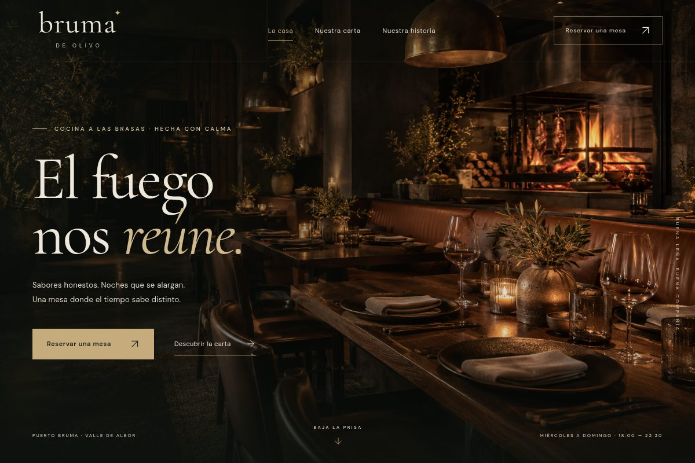
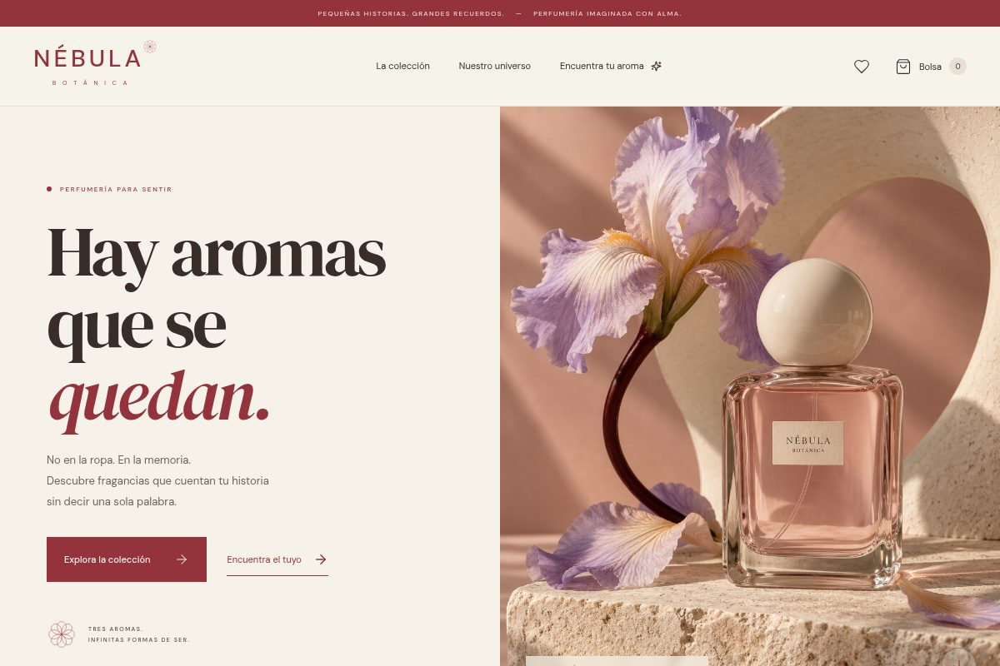
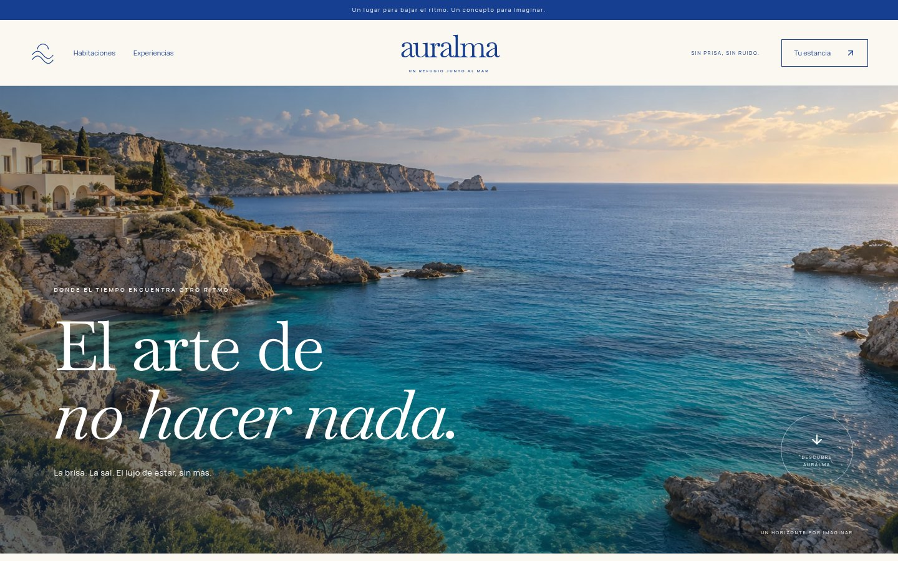

# Archivo de ideas · portafolio de conceptos

Tres proyectos originales, con marcas ficticias e imágenes generadas con IA. Funcionan en un navegador moderno sin instalación ni conexión a Internet.

## Descargar el portafolio completo

**[portafolio-v2.zip](portafolio-v2.zip)**

1. Abre el archivo en GitHub y pulsa **Download raw file**.
2. Extrae todos sus archivos a la misma carpeta.
3. Abre **`index.html`**: encontrarás una portada para elegir entre los tres proyectos.

El ZIP contiene la portada, `bruma-de-olivo.html`, `nebula-botanica.html`, `auralma.html` y `LEEME.txt`. Los HTML ya incluyen sus imágenes, fuentes y código. Al pie de cada sitio hay un enlace para volver al portafolio.

La edición anterior de dos proyectos continúa disponible en [portafolio-v1.zip](portafolio-v1.zip).

Para abrirlos en línea, consulta la [preparación de GitHub Pages](GITHUB-PAGES.md). Los archivos están listos en la rama `gh-pages`; la activación desde Settings está pendiente.

## 01 · Bruma de Olivo

Una parrilla nocturna, íntima y sofisticada. Páginas de inicio, carta por categorías, historia y reservas de muestra.

[Descargar solamente Bruma de Olivo](bruma-de-olivo-v1.zip). Extrae y abre `bruma-de-olivo.html`.

## 02 · Nébula Botánica

Una casa de perfumería luminosa y editorial. Incluye catálogo por familias, tres fichas con variantes, favoritos, bolsa con cantidades y subtotales, historia de marca y un cuestionario para recomendar un aroma.

[Descargar solamente Nébula Botánica](nebula-botanica-v1.zip). Extrae y abre `nebula-botanica.html`.

## 03 · Auralma

Un hotel boutique costero de azul profundo, blanco sal y arena. Incluye inicio, habitaciones con filtro de capacidad y galerías, experiencias por categorías y una estancia de muestra con fechas, huéspedes, suites, complementos, totales y revisión editable. Seis imágenes originales generadas con IA.

[Descargar solamente Auralma](auralma-v1.zip). Extrae y abre `auralma.html`.

## Sobre estas propuestas

Todos los nombres comerciales, productos, precios, historias y datos de los negocios son ficticios. Se generaron cinco imágenes originales para Bruma y Nébula, y seis para Auralma. Las compras y reservas son demostraciones: no se cobran importes, no se tramitan pedidos ni se envían datos personales.

No se necesita un servidor para revisar los HTML en un navegador personal. Se han probado las aplicaciones en escritorio y móvil emulado, además de las exportaciones independientes. Esto no representa una publicación en un dominio comercial.

Los tamaños y las sumas de verificación de los ZIP se incluyen en [manifest.json](manifest.json).
